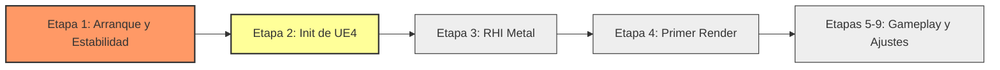

# Stray en iOS — Investigación de Compatibilidad Técnica

> ¿Puede la versión original de **Stray** para macOS Apple Silicon ejecutarse en un iPhone físico?
> 
> *Stray iOS inicia un nuevo ciclo de desarrollo. El proyecto establece una línea base técnica limpia y reorganiza su hoja de ruta pública en torno a los objetivos actuales de implementación.*

[Read in English](README.md) · [Estado del Proyecto](PROJECT_STATUS.md) · [Hoja de Ruta](ROADMAP.md) · [Arquitectura](docs/ARCHITECTURE.md) · [Bloqueos Actuales](docs/CURRENT_BLOCKERS.md)

---

## 1. Resumen y Alcance del Proyecto

Este repositorio documenta un experimento técnico independiente para evaluar si la versión compilada para macOS ARM64 de **Stray** (desarrollada sobre Unreal Engine 4) puede ejecutarse dentro del contenedor de una aplicación de iOS en un iPhone 17 Pro Max físico, utilizando shims de compatibilidad en espacio de usuario derivados de [macos-on-ios-public](https://github.com/zorrobyte/macos-on-ios-public).

El ejecutable del juego (`Stray-Mac-Shipping`) se mantiene como el binario Mach-O original de macOS. El trabajo utiliza adaptación de cabeceras de plataforma, reescritura de rutas de carga dinámica (RPATHs) y shims en tiempo de ejecución (puente AppKit -> UIKit, descubrimiento de GPU en IOKit, traducción de modos de almacenamiento Metal) para salvar las diferencias entre plataformas.

> [!IMPORTANT]
> **Investigación Exclusiva — Sin Distribución de Archivos del Juego:** Este repositorio contiene únicamente documentación, análisis de diagnóstico y código de shims. **No** distribuye ejecutables del juego, archivos PAK, texturas con derechos de autor, modelos 3D, pistas de audio ni certificados de firma.

---

## 2. Estado Técnico Actual

### Hechos Verificados (Confirmados en Dispositivo Físico)
- **Dispositivo Objetivo:** iPhone 17 Pro Max, iOS 27.3, Apple Silicon.
- **Conversión del Binario:** Comando de carga Mach-O adaptado a la plataforma iOS mediante `vtool`; firmado con perfil Personal Team e instalado mediante `devicectl` (Código de Salida 0).
- **Sensibilidad a Mayúsculas/Minúsculas:** El cuadro de alerta modal bloqueante (*Unreal Engine does not support running from case-sensitive file systems*) queda neutralizado mediante un hook en `NSURL` que devuelve `NO` para `NSURLVolumeSupportsCaseSensitiveNamesKey`.
- **Descubrimiento de Recursos ICU:** El fallo fatal `ICU data directory was not discovered` queda resuelto extrayendo los datos de recursos ICU (3.463 archivos) a `Documents/stray/StrayICU` junto con una redirección en el shim.
- **Reconocimiento del Hardware:** Los hooks de `sysctl` que reportan `hw.model` como `Mac16,12` permiten a Unreal Engine reconocer la plataforma como `Device Type: Mac16,12` / `Matched Mac as MacGame`.
- **Captura de Salida:** El hook interceptor de `_Exit` captura trazas de llamadas (backtrace) y estado global del motor antes de la salida del proceso.

### Aspectos que Aún No Funcionan (Control de Realidad)
- **Terminación Temprana:** El proceso finaliza ~3 segundos después del lanzamiento con código de salida 1 (`_Exit(1)` invocado desde `-[UE4AppDelegate runGameThread:]`).
- **Sin Renderizado:** No se muestra ningún gráfico ni interfaz en la pantalla del dispositivo. El estado del motor al salir confirma `GDynamicRHI == 0x0`, `GIsRHIInitialized == 0` y `GIsMetalInitialized == 0`.
- **Controles y Audio:** Los sistemas de audio y de entrada táctil/mando no se han inicializado ni alcanzado en esta fase.

---

## 3. Investigación Prioritaria: El Bloqueo de Salida Temprana

El desensamblado de `PlatformCreateDynamicRHI` (`0x101a28268`) y `FMetalDynamicRHI::FMetalDynamicRHI` (`0x101219188`) ha revelado la secuencia causal de la terminación:

1. **Fallback de Nivel de Características:** Sin `-metalsm5` en el parseo inicial de la línea de comandos, el nivel de características retrocede al valor predeterminado `4`.
2. **Discrepancia de Plataforma de Shaders:** El nivel `4` provoca la selección de la plataforma de shaders 18 (`SP_METAL_MAC_ES3_1` / `"SF_METAL"`).
3. **Validación Fatal:** `FMetalDynamicRHI` compara la plataforma 18 frente a los `TargetedRHIs` (`SF_METAL_SM5` = 16) definidos en `BaseEngine.ini`. La falta de coincidencia dispara un error fatal de bajo nivel y activa `GIsRequestingExit = 1`.
4. **Aborto en Milestone 11:** Al no instanciarse `GDynamicRHI`, el Milestone 11 intenta cargar `GlobalShaderCache-None.bin`, falla e invoca `_Exit(1)`.

Consulte [docs/CURRENT_BLOCKERS.md](docs/CURRENT_BLOCKERS.md) para revisar los registros forenses completos, volcados de registros y trazas de desensamblado.

---

## 4. Hoja de Ruta en Nueve Etapas

El proyecto sigue una progresión estricta de 9 etapas de ingeniería:

| Etapa | Objetivo | Estado |
|---|---|---|
| **Etapa 1** | **Arranque del Proceso y Estabilidad** | **En Progreso (Bloqueo Activo)** |
| **Etapa 2** | **Inicialización de Unreal Engine** | **En Progreso** |
| **Etapa 3** | **Inicialización de Metal y RHI** | **Bloqueada por Etapa 2** |
| **Etapa 4** | **Primer Renderizado en Pantalla** | No iniciada |
| **Etapa 5** | **Geometría del Escenario y Personaje** | No iniciada |
| **Etapa 6** | **Materiales, Texturas e Iluminación** | No iniciada |
| **Etapa 7** | **Recuperación del Canal de Audio** | No iniciada |
| **Etapa 8** | **Controles de Entrada y Jugabilidad** | No iniciada |
| **Etapa 9** | **Rendimiento, Térmica y Sesiones Prolongadas** | No iniciada |

Los criterios detallados de validación para cada etapa se encuentran en [ROADMAP.md](ROADMAP.md).

---

## 5. Índice de Documentación Técnica

- [PROJECT_STATUS.md](PROJECT_STATUS.md) — Matriz de evidencias y registros verificados de pruebas.
- [ROADMAP.md](ROADMAP.md) — Hoja de ruta en 9 etapas y criterios de verificación.
- [CHANGELOG.md](CHANGELOG.md) — Registro cronológico de cambios y avances.
- [docs/ARCHITECTURE.md](docs/ARCHITECTURE.md) — Explicación profunda de shims, modificación Mach-O y puente en tiempo de ejecución.
- [docs/CURRENT_BLOCKERS.md](docs/CURRENT_BLOCKERS.md) — Desensamblado, análisis de slide ASLR y diagnóstico de salida.
- [docs/INSTALLATION.md](docs/INSTALLATION.md) — Procedimiento paso a paso de conversión, firma, instalación y watchdog.
- [docs/METAL-COMPATIBILITY.md](docs/METAL-COMPATIBILITY.md) — Modos de almacenamiento Metal, plataformas de shaders y spoofing de GPU.
- [archive/previous-development/](archive/previous-development/) — Documentos y notas archivadas de etapas exploratorias anteriores.

---

## 6. Proyectos de Origen y Directrices

- **Proyecto Upstream:** La base de compatibilidad procede de [macos-on-ios-public](https://github.com/zorrobyte/macos-on-ios-public) por Ross Fisher (Licencia MIT). Ver [UPSTREAM.md](UPSTREAM.md).
- **Directrices de Publicación:** Consulte [PUBLISHING-SCOPE.md](PUBLISHING-SCOPE.md) para conocer las políticas de no distribución de activos.
- **Contribuciones:** Consulte [CONTRIBUTING.md](CONTRIBUTING.md) para participar en la investigación.
