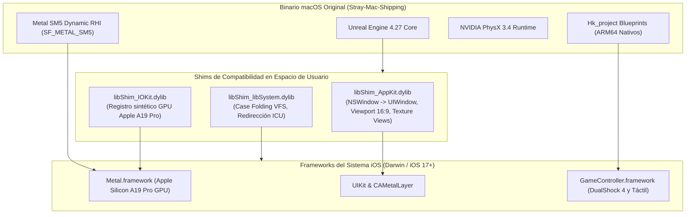

# Stray en iOS — Investigación de Compatibilidad Técnica

> [!CAUTION]
> **ESTADO HONESTO DEL PROYECTO (NOVIEMBRE 2026):**
> **Stray NO ha sido portado con éxito a iOS todavía. NO es completamente jugable.**
> 
> Aunque hemos conseguido la ejecución nativa del binario macOS ARM64 original sin recompilar en un iPhone 17 Pro Max físico, con inicialización completa de Metal SM5 Desktop RHI y renderizado del escenario 3D a 25–33 FPS, la salida visual es incompleta: el gato protagonista solo se dibuja como una silueta negra, falta el pelaje procedural, las texturas se mantienen en baja resolución y el fondo 3D del menú aparece en negro.
> 
> Este repositorio documenta la investigación técnica e ingeniería inversa en curso. No se distribuyen binarios propietarios ni assets con derechos de autor.

[In English](README.md) · [Estado del Proyecto](PROJECT_STATUS.md) · [Hoja de Ruta](ROADMAP.md) · [Ayuda Técnica y Reddit](community/REDDIT_TECHNICAL_HELP.md) · [Arquitectura](docs/ARCHITECTURE.md)

---

## 1. Alcance y Visión General

Este repositorio documenta un experimento técnico independiente que investiga si el ejecutable comercial ARM64 para macOS de **Stray** (desarrollado en Unreal Engine 4.27.2) puede ejecutarse dentro del sandbox de una aplicación iOS en hardware físico Apple Silicon (iPhone 17 Pro Max), utilizando capas de compatibilidad en espacio de usuario derivadas de [macos-on-ios-public](https://github.com/zorrobyte/macos-on-ios-public) por Ross Fisher.

El binario del juego (`Stray-Mac-Shipping`) se mantiene como el ejecutable Mach-O original de macOS. El experimento utiliza adaptación de cabeceras de plataforma Mach-O (`LC_BUILD_VERSION`), ajuste de rutas de carga dinámica (RPATHs) y shims en tiempo de ejecución (`AppKit` -> `UIKit`, registro sintético de GPU en `IOKit` y traducción de modos de memoria Metal).



---

## 2. Estado Actual de la Ingeniería (Tests 1 a 41)

### Lo que Funciona (Verificado en iPhone 17 Pro Max Físico)
- **Conversión de Mach-O y Firma:** Cabeceras adaptadas a plataforma iOS (`minos 17.0`, `sdk 27.1`) mediante `vtool`; firmado con perfil Apple Developer Personal Team e instalado mediante `devicectl` (Código de Salida 0).
- **Bypass de Sensibilidad a Mayúsculas:** El diálogo bloqueante (*Unreal Engine does not support running from case-sensitive file systems*) se elude mediante un hook en `NSURL` que retorna `NO` para `NSURLVolumeSupportsCaseSensitiveNamesKey`.
- **Internacionalización ICU:** Error fatal de recursos ICU resuelto extrayendo 3.463 archivos ICU (22 MB) de `pakchunk0-MacNoEditor.pak` y redirigiéndolos mediante shim VFS.
- **Identificación de Hardware y GPU:** Sysctl interceptado (`Mac16,12` / `arm64`) y registro sintético en `IOKit` con `Apple A19 Pro GPU` (`vendorId=0x106b`, `plugin=AGXMetalG18P`), eliminando totalmente los cuelgues SIGSEGV de inicio.
- **Inicialización de Metal SM5 RHI:** Desktop Shader Model 5 Metal RHI (`SF_METAL_SM5`) completamente operativo: `GDynamicRHI = 0x12298af00`, `GIsRHIInitialized = 1`, `GIsMetalInitialized = 1`.
- **Modos de Almacenamiento Metal y Texture Views:** `MTLStorageModeManaged` se traduce a `MTLStorageModeShared`. Interposición en `-[MTLTexture newTextureViewWithPixelFormat:]` evita cuelgues al crear vistas depth (`260 -> 252`) y stencil (`260 -> 261`).
- **Renderizado de Geometría 3D:** El escenario del nivel (túneles, tuberías metálicas, válvulas circulares y conductos) se renderiza en pantalla en tiempo real.
- **Tasa de Cuadros y Estabilidad:** **25–33 FPS sostenidos** en el nivel 3D; 60 FPS en menús Slate UI. Consumo de 2.65 GB RAM sin alertas de presión térmica o de memoria.
- **Controles e Input:** Superposición táctil virtual funcional. Controladores DualShock 4 conectados ocultan automáticamente la interfaz táctil y asumen el control.

### Lo que NO Funciona (Bloqueadores Activos)
- **Sombreado del Gato Protagonista:** La malla del gato se rasteriza físicamente y ocluye las tuberías/válvulas del fondo, pero aparece como una **silueta negra**. Causas raíz aisladas:
  1. El material utiliza `MSM_SubsurfaceProfile` (`/Game/Character/Cat/Material/SSS_profil_cat`), que requiere un pase de post-procesado de desenfoque bilateral en espacio de pantalla (`FPostProcessSubsurface`) que falla en iOS Metal.
  2. Mallas esqueléticas móviles dinámicas en niveles con iluminación estática horneada dependen del muestreo de Volumetric Lightmap (VLM), el cual evalúa a 0.0 lúmenes en túneles interiores oscuros.
- **Pelaje Procedural (GFur PRO):** El plugin GFur oculta la malla base (`bHideSkin=1`, `bVisible=0`) esperando dibujar capas de pelo con compute shaders. En iOS Metal, estos shaders no se ejecutan.
- **Fondo 3D del Menú Principal:** La pantalla de título muestra fondo negro; solo los widgets táctiles Slate/UMG se dibujan.
- **Streaming de Texturas de Escritorio:** Las texturas utilizan compresión BC1–BC7 de escritorio. El streaming de mips desde `.ubulk` requiere ajuste de memoria.
- **Orientación de Cámara:** La orientación horizontal y el giro de cámara táctil requieren ajuste fino adicional.

---

## 3. Matriz de Fases de Desarrollo (9 Etapas)

| Etapa | Hito | Estado | Evidencia Verificada |
|---|---|---|---|
| **Etapa 1** | **Estabilidad de Proceso y Lanzamiento** | **SUPERADA** | Watchdog automatizado, cero cierres abruptos al arrancar. |
| **Etapa 2** | **Inicialización de Unreal Engine** | **SUPERADA** | `FEngineLoop::AppInit` completado; tablas ICU cargadas. |
| **Etapa 3** | **Inicialización de Metal y RHI** | **SUPERADA** | `GDynamicRHI` vivo; `SF_METAL_SM5` activo. |
| **Etapa 4** | **Primera Salida Visual en Pantalla** | **SUPERADA** | Presentación 16:9 centrada en `CAMetalLayer` a 60 FPS. |
| **Etapa 5** | **Geometría del Escenario y Personaje** | **EN PROGRESO** | Escenario 3D a 25-33 FPS. Silueta del gato presente; sombreado incompleto. |
| **Etapa 6** | **Materiales, Texturas e Iluminación** | **EN PROGRESO** | Bloqueado por `MSM_SubsurfaceProfile` e iluminación VLM. |
| **Etapa 7** | **Recuperación del Pipeline de Audio** | **EN PROGRESO** | Hilo de audio activo; streaming Wwise pendiente de validación. |
| **Etapa 8** | **Controles de Entrada y Jugabilidad** | **EN PROGRESO** | Superposición táctil y DualShock 4 operativos. |
| **Etapa 9** | **Rendimiento, Térmica y Estabilidad** | **EN PROGRESO** | 25-33 FPS, 2.65 GB RAM, estado térmico nominal. |

---

## 4. Paquete Comunitario y Ayuda Técnica

Buscamos activamente recomendaciones de programadores gráficos y especialistas en ingeniería inversa de **UE4 Metal RHI** y **modelos de sombreado diferido**:
- 📖 **Informe Técnico Detallado:** [community/REDDIT_TECHNICAL_HELP.md](community/REDDIT_TECHNICAL_HELP.md)
- 💬 **Borrador para Reddit:** [community/REDDIT_POST.md](community/REDDIT_POST.md)
- 🔬 **Diagnósticos y Trazas Binarias:** [community/diagnostics/](community/diagnostics/)

---

## 5. Compilación de los Shims

Para compilar las librerías dinámicas de compatibilidad en macOS con Xcode:

```bash
# Compilar shims para arm64-apple-ios17.0
./scripts/compile_shims.sh build/shims
```

O revise los flujos automatizados de GitHub Actions:
- `.github/workflows/ios-build.yml` — Compilación y validación de símbolos en runners `macos-14`.
- `.github/workflows/ios-diagnostics.yml` — Validación estática de configuraciones y limpieza del repositorio.
