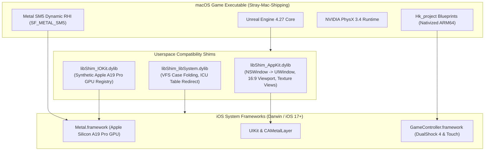

# Stray on iOS — Technical Compatibility Research

> [!CAUTION]
> **HONEST PROJECT STATUS (NOVEMBER 2026):**
> **Stray has NOT been successfully ported to iOS yet. It is NOT fully playable.**
> 
> While we have achieved native execution of the un-recompiled ARM64 macOS binary on a physical iPhone 17 Pro Max with Desktop Metal SM5 RHI initialization and 3D world geometry rendering at 25–33 FPS, the visual output is incomplete: the cat protagonist renders only as a black silhouette, procedural fur is missing, textures remain low-resolution, and the 3D menu background is black.
> 
> This repository documents ongoing reverse-engineering and graphics research. No game executables or proprietary assets are distributed here.

[En español](README.es.md) · [Project Status](PROJECT_STATUS.md) · [Development Roadmap](ROADMAP.md) · [Technical Help & Reddit](community/REDDIT_TECHNICAL_HELP.md) · [Architecture](docs/ARCHITECTURE.md)

---

## 1. Project Overview & Scope

This repository documents an independent technical experiment exploring whether the compiled ARM64 macOS release of **Stray** (built on Unreal Engine 4.27.2) can be executed inside an iOS application container on a physical iPhone 17 Pro Max using userspace compatibility shims derived from [macos-on-ios-public](https://github.com/zorrobyte/macos-on-ios-public) by Ross Fisher.

The game binary (`Stray-Mac-Shipping`) remains the original macOS Mach-O executable. The experiment uses binary platform header adaptation (`LC_BUILD_VERSION`), dynamic library load path adjustments, and runtime shims (`AppKit` -> `UIKit`, synthetic `IOKit` GPU discovery, and Metal storage mode translation) to bridge platform differences.



---

## 2. Current Engineering Status (Tests 1 to 41)

### What Works (Verified on iPhone 17 Pro Max)
- **Binary Conversion & Code Signing:** Mach-O platform headers adapted to iOS platform load commands (`minos 17.0`, `sdk 27.1`) via `vtool`; signed with Apple Developer Personal Team profile and installed via `devicectl` (Exit Code 0).
- **Filesystem Case-Sensitivity Bypass:** Modal alert (*Unreal Engine does not support running from case-sensitive file systems*) bypassed via `NSURL` hook returning `NO` for `NSURLVolumeSupportsCaseSensitiveNamesKey`.
- **ICU Internationalization:** Missing ICU data crash resolved by extracting 3,463 ICU resource files (22 MB) from `pakchunk0-MacNoEditor.pak` to the app container with a VFS shim redirect.
- **Hardware Recognition & GPU Registration:** Intercepted `sysctlbyname` (`Mac16,12` / `arm64`) and synthetic `IOKit` registry populate `Apple A19 Pro GPU` (`vendorId=0x106b`, `plugin=AGXMetalG18P`), completely eliminating startup SIGSEGV crashes.
- **Metal SM5 RHI Initialization:** Desktop Shader Model 5 Metal RHI (`SF_METAL_SM5`) fully initializes: `GDynamicRHI = 0x12298af00`, `GIsRHIInitialized = 1`, `GIsMetalInitialized = 1`.
- **Metal Storage Mode & Texture Views:** `MTLStorageModeManaged` is sanitized to `MTLStorageModeShared`. Interposers on `-[MTLTexture newTextureViewWithPixelFormat:]` prevent crashes when creating depth (`260 -> 252`) and stencil (`260 -> 261`) texture views.
- **3D World Geometry Rendering:** In-game environment geometry (tunnel walls, steel pipes, circular valves, ventilation shafts) renders to screen in real-time.
- **Frame Rate & Stability:** Sustained **25–33 FPS** on device during 3D level execution; 60 FPS in Slate UI menus. Memory reaches 2.65 GB RAM without memory pressure warnings.
- **Controls & Input:** On-screen virtual gamepad overlay operates smoothly. Connected DualShock 4 controllers automatically hide the on-screen HUD and assume control.

### What Does NOT Work (Current Blockers)
- **Cat Protagonist Shading:** The cat mesh is physically rasterized and occludes background pipes/valves, but renders as a **pitch-black silhouette**. Root causes:
  1. Material uses `MSM_SubsurfaceProfile` (`/Game/Character/Cat/Material/SSS_profil_cat`), which requires screen-space bilateral blur post-processing (`FPostProcessSubsurface`) that fails on iOS Metal.
  2. Dynamic movable skeletal meshes in static-baked levels rely on Volumetric Lightmap (VLM) indirect diffuse sampling, which evaluates to 0.0 lumens in dark interior tunnels.
- **Procedural Fur (GFur PRO):** The GFur plugin suppresses the base skin proxy (`bHideSkin=1`, `bVisible=0`) expecting procedural fur shells to draw. On iOS Metal, GFur compute shaders do not render.
- **Main Menu 3D Background:** The title screen menu background is pitch black; only UMG/Slate touch widgets render.
- **Desktop Texture Streaming:** Textures use desktop BC1–BC7 compression. Mip streaming from `.ubulk` files requires pool expansion.
- **Camera Orientation:** Viewport landscape orientation and touch camera orbit require additional fine-tuning.

---

## 3. Engineering Progression (9 Stages)

| Stage | Milestone | Status | Verified Evidence |
|---|---|---|---|
| **Stage 1** | **Process Stability & Launch** | **PASS** | Automated watchdog execution, zero crash on startup. |
| **Stage 2** | **Unreal Engine Initialization** | **PASS** | `FEngineLoop::AppInit` completed; ICU tables loaded. |
| **Stage 3** | **Metal & RHI Initialization** | **PASS** | `GDynamicRHI` alive; `SF_METAL_SM5` active. |
| **Stage 4** | **First Screen Rendering** | **PASS** | 16:9 centered presentation to `CAMetalLayer` at 60 FPS. |
| **Stage 5** | **Scene Geometry & Character** | **IN PROGRESS** | 3D level geometry renders at 25-33 FPS. Cat silhouette rasterized; shading incomplete. |
| **Stage 6** | **Materials, Textures & Lighting** | **IN PROGRESS** | Blocked by `MSM_SubsurfaceProfile` and VLM lighting evaluation. |
| **Stage 7** | **Audio Pipeline Recovery** | **IN PROGRESS** | Audio thread active; Wwise audio streaming pending verification. |
| **Stage 8** | **Input Controls & Gameplay** | **IN PROGRESS** | Touch virtual gamepad and DualShock 4 operational. |
| **Stage 9** | **Performance & Thermals** | **IN PROGRESS** | 25-33 FPS, 2.65 GB RAM, `thermal=nominal` in 60s windows. |

---

## 4. Community & Technical Help

We are actively seeking insights from graphics programmers and reverse engineers experienced with **UE4 Metal RHI** and **deferred shading models**.

- 📖 **In-Depth Technical Report:** [community/REDDIT_TECHNICAL_HELP.md](community/REDDIT_TECHNICAL_HELP.md)
- 💬 **Reddit Community Draft:** [community/REDDIT_POST.md](community/REDDIT_POST.md)
- 🔬 **Sanitized Diagnostics & Binary Traces:** [community/diagnostics/](community/diagnostics/)
  - `test33_metal_rhi_init.log` — First Metal SM5 RHI initialization log.
  - `test37_clean_3d_render.log` — 25-33 FPS 3D level rendering log.
  - `test40_bone_probe_trace.txt` — Binary probe trace disproving bone limit check failure.
  - `test41_silhouette_analysis.md` — Forensic analysis of cat silhouette rasterization.
  - `binary_cave_disassembly.txt` — ARM64 disassembly of hooks and caves.
  - `Engine.sanitized.ini` — Verified baseline configuration preserving plugin content paths.

---

## 5. Building the Shims

You can build all dynamic library shims locally on macOS with Xcode command-line tools:

```bash
# Build shims targeting arm64-apple-ios17.0
./scripts/compile_shims.sh build/shims
```

Or inspect our automated CI build pipeline:
- `.github/workflows/ios-build.yml` — Automated compilation and symbol verification on `macos-14` runners.
- `.github/workflows/ios-diagnostics.yml` — Automated configuration syntax and repository cleanliness checks.

---

## 6. Upstream & Publishing Scope

- **Upstream Project:** Compatibility infrastructure is based on [macos-on-ios-public](https://github.com/zorrobyte/macos-on-ios-public) by Ross Fisher (MIT License).
- **Non-Distribution Policy:** This repository does NOT contain copyrighted game assets, executables, PAK files, or Apple developer provisioning profiles. See [PUBLISHING-SCOPE.md](PUBLISHING-SCOPE.md).
