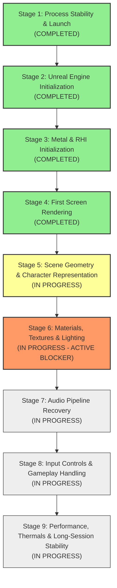

# Stray iOS — Development Roadmap

This roadmap defines the structured implementation stages for running the original macOS (Apple Silicon, ARM64) version of **Stray** on iOS (specifically targeting the iPhone 17 Pro Max, iOS 27.x) using compatibility shims.

The project operates under a strict, evidence-based engineering methodology: **no stage is marked as complete without reproducible, verified logs or artifacts from the physical target device.**

---

## Development Stages Overview

---

## Detailed Stages

### Stage 1: Application Launch & Process Stability
* **Goal:** Launch the application binary inside an iOS container on physical hardware, establish runtime hooks, and maintain the process alive without early termination.
* **Current Status:** **COMPLETED (Pass)**
* **Verification Criteria:**
  - [x] Application bundle installs successfully on iPhone via `devicectl` (Exit Code 0).
  - [x] Code signature and provisioning profile trusted by iOS.
  - [x] Process launches and executes initialization threads.
  - [x] Filesystem case-sensitivity check bypassed without modal alert.
  - [x] ICU internationalization resource discovery resolved (3,463 files extracted & redirected).
  - [x] Hardware identified as Apple Silicon Mac (`Mac16,12` / `arm64`).
  - [x] Process runs under automated watchdog control.

### Stage 2: Unreal Engine Initialization
* **Goal:** Ensure `FEngineLoop::PreInit` and `FEngineLoop::Init` complete all engine subsystem initializations without triggering `RequestExit` or fatal errors.
* **Current Status:** **COMPLETED (Pass)**
* **Verification Criteria:**
  - [x] `GuardedMain` executes cleanly.
  - [x] `GIsRequestingExit` remains `0` during active gameplay.
  - [x] Module loading and plugin initialization complete.
  - [x] Engine configuration files (`BaseEngine.ini`, `DefaultEngine.ini`, `Engine.ini`) correctly parsed and merged non-destructively.
  - [x] Engine reaches `FEngineLoop::Tick` and ticks game logic.

### Stage 3: Metal Graphics & RHI Initialization
* **Goal:** Initialize `FMetalDynamicRHI`, establish the Metal command queue, select supported shader platform formats, and load the global shader cache.
* **Current Status:** **COMPLETED (Pass)**
* **Verification Criteria:**
  - [x] `GDynamicRHI` is successfully instantiated (`0x12298af00`).
  - [x] `GIsRHIInitialized` and `GIsMetalInitialized` transition to `1`.
  - [x] Shader platform selected matches cooked shaders (`SF_METAL_SM5`).
  - [x] Global shader cache (`GlobalShaderCache-SF_METAL_SM5.bin`) opens and loads without format mismatches.
  - [x] Metal storage modes translated properly (`MTLStorageModeManaged` -> `MTLStorageModeShared`).
  - [x] Interposer handles texture view format remappings for depth and stencil.

### Stage 4: First Screen Rendering Output
* **Goal:** Present the first rendered frame from Unreal Engine through `CAMetalLayer` onto the iPhone display.
* **Current Status:** **COMPLETED (Pass)**
* **Verification Criteria:**
  - [x] Viewport correctly binds to hosting `UIWindow` / `CAMetalLayer`.
  - [x] Framebuffer clears and swapchain presentation succeeds at 60 FPS in Slate UI.
  - [x] Visual verification of on-screen Slate UI widgets and splash screen.
  - [x] 16:9 aspect fit (`1536x864` drawable) centered with safe area insets.

### Stage 5: Scene Geometry & Character Representation
* **Goal:** Correctly render 3D world geometry, level static meshes, dynamic skeletal meshes, and the player character.
* **Current Status:** **IN PROGRESS**
* **Verification Criteria:**
  - [x] 3D world geometry (tunnel walls, steel pipes, circular valves, ductwork) renders in real-time.
  - [x] Cat protagonist skeletal mesh is rasterized (confirmed by pixel forensics occluding background geometry).
  - [x] Binary code cave probe refutes bone limit check failure (section bone count = 14 vs 256 limit).
  - [ ] **Active Blocker:** Cat protagonist renders as a pitch-black silhouette.
  - [ ] **Active Blocker:** Procedural fur shells (GFur PRO) do not render.
  - [ ] **Active Blocker:** 3D main menu background renders black.

### Stage 6: Materials, Textures & Lighting (ACTIVE FOCUS)
* **Goal:** Render authentic materials, PBR lighting, dynamic shadows, and high-resolution texture streaming.
* **Current Status:** **IN PROGRESS (Active Blocker)**
* **Verification Criteria:**
  - [ ] Subsurface scattering post-process pass (`FPostProcessSubsurface`) evaluated or bypassed cleanly via `r.SubsurfaceScattering=0`.
  - [ ] Volumetric Lightmap (VLM) indirect diffuse sampling active for dynamic skeletal actors.
  - [ ] Texture streaming loads desktop BC1–BC7 mips from `pakchunk0_s1-MacNoEditor.pak` without blurriness.
  - [ ] Dynamic directional and spot lighting passes evaluate without clipping or overexposure.

### Stage 7: Audio Pipeline Recovery
* **Goal:** Re-establish spatial audio, ambient sound effects, and Wwise soundbank playback.
* **Current Status:** **IN PROGRESS**
* **Verification Criteria:**
  - [x] Audio mixer thread initialized.
  - [ ] Wwise soundbanks stream and trigger without starvation.

### Stage 8: Input Controls & Gameplay Handling
* **Goal:** Full game controllability via touch gestures, virtual buttons, and external controllers.
* **Current Status:** **IN PROGRESS**
* **Verification Criteria:**
  - [x] On-screen virtual gamepad overlay responsive to touch events.
  - [x] Physical DualShock 4 controller auto-detected; hides touch HUD and drives movement.
  - [ ] Camera look and orbit rotation mapped to landscape touch gestures.

### Stage 9: Performance, Thermals & Long-Session Stability
* **Goal:** Sustain 30+ FPS over 15+ minute gameplay sessions without thermal throttling or memory exhaustion.
* **Current Status:** **IN PROGRESS**
* **Verification Criteria:**
  - [x] Sustained 25–33 FPS on Apple A19 Pro GPU during 60-second test window.
  - [x] Memory usage scales safely to 2.65 GB RAM without memory warnings.
  - [x] Thermal state remains nominal under watchdog execution.
  - [ ] Validate long-running session (> 5 minutes) once physical testing resumes.
