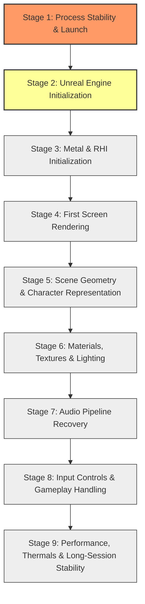

# Stray iOS — Development Roadmap

This roadmap defines the structured implementation stages for running the original macOS (Apple Silicon, ARM64) version of **Stray** on iOS (specifically targeting the iPhone 17 Pro Max, iOS 27.3) using compatibility shims.

The project operates under a strict, evidence-based engineering methodology: **no stage is marked as complete without reproducible, verified logs or artifacts from the physical target device.**

---

## Development Stages Overview

---

## Detailed Stages

### Stage 1: Application Launch & Process Stability (ACTIVE FOCUS)
* **Goal:** Launch the application binary inside an iOS container on physical hardware, establish runtime hooks, and maintain the process alive without early termination.
* **Current Status:** **IN PROGRESS (Blocked on early termination)**
* **Verification Criteria:**
  - [x] Application bundle installs successfully on iPhone via `devicectl`.
  - [x] Code signature and provisioning profile trusted by iOS.
  - [x] Process launches and executes initialization threads.
  - [x] Filesystem case-sensitivity check bypassed without modal alert.
  - [x] ICU internationalization resource discovery resolved.
  - [x] Hardware identified as Apple Silicon Mac (`Mac16,12`).
  - [ ] **Active Blocker:** Process currently terminates after ~3 seconds with exit code 1 (`_Exit(1)`).

### Stage 2: Unreal Engine Initialization
* **Goal:** Ensure `FEngineLoop::PreInit` and `FEngineLoop::Init` complete all engine subsystem initializations without triggering `RequestExit` or fatal errors.
* **Current Status:** **IN PROGRESS**
* **Verification Criteria:**
  - [ ] `GuardedMain` does not return error code 1.
  - [ ] `GIsRequestingExit` remains `0`.
  - [ ] Module loading and plugin initialization complete cleanly.
  - [ ] Engine configuration files (`BaseEngine.ini`, `DefaultEngine.ini`) correctly parsed from PAK or disk.
  - [ ] Engine reaches `FEngineLoop::Tick`.

### Stage 3: Metal Graphics & RHI Initialization
* **Goal:** Initialize `FMetalDynamicRHI`, establish the Metal command queue, select supported shader platform formats, and load the global shader cache.
* **Current Status:** **NOT STARTED (Dependent on Stage 2)**
* **Verification Criteria:**
  - [ ] `GDynamicRHI` is successfully instantiated (`!= 0x0`).
  - [ ] `GIsRHIInitialized` and `GIsMetalInitialized` transition to `1`.
  - [ ] Shader platform selected matches cooked shaders (`SF_METAL_SM5`).
  - [ ] Global shader cache (`GlobalShaderCache-SF_METAL_SM5.bin`) opens and loads without format mismatches.
  - [ ] Metal storage modes translated properly (macOS Managed storage -> iOS Shared storage).

### Stage 4: First Screen Rendering Output
* **Goal:** Present the first rendered frame from Unreal Engine through `CAMetalLayer` onto the iPhone display.
* **Current Status:** **NOT STARTED**
* **Verification Criteria:**
  - [ ] Viewport correctly binds to the hosting `UIView` / `CAMetalLayer`.
  - [ ] Framebuffer clears and first swapchain presentation succeeds.
  - [ ] Visual verification of on-screen content (splash screen, loading screen, or initial menu).
  - [ ] Landscape orientation and aspect ratio reconciled with device screen bounds.

### Stage 5: Scene Geometry & Character Representation
* **Goal:** Correctly render 3D world geometry, level static meshes, dynamic skeletal meshes, and the player character.
* **Current Status:** **NOT STARTED**
* **Verification Criteria:**
  - [ ] Level streaming / map loading completes without crash.
  - [ ] Static mesh scene proxies render correctly with valid depth/stencil.
  - [ ] Skeletal mesh deformation and vertex skinning function on the Apple GPU.
  - [ ] Player character mesh is clearly identifiable on screen.

### Stage 6: Textures, Materials & Lighting
* **Goal:** Restore full texture streaming, material shaders, and correct lighting/exposure pipelines.
* **Current Status:** **NOT STARTED**
* **Verification Criteria:**
  - [ ] Texture streaming loads mipmaps from PAK files without blank/black textures.
  - [ ] Material permutations compile and bind appropriate Metal pipelines.
  - [ ] Screen-space reflections, shadows, and post-processing exposure render naturally.

### Stage 7: Audio Pipeline Recovery
* **Goal:** Re-route engine audio from macOS CoreAudio backends to iOS audio session frameworks.
* **Current Status:** **NOT STARTED**
* **Verification Criteria:**
  - [ ] `AVAudioSession` initialized in playback category.
  - [ ] Sound mixer output mapped to device speakers/headphones.
  - [ ] Video playback audio (Bink 2) and in-game audio playback functional without stutter.

### Stage 8: Input Controls & Gameplay Handling
* **Goal:** Map touch screen inputs and external gamepads (MFi / PlayStation DualShock 4 / Xbox controllers) to engine input events.
* **Current Status:** **NOT STARTED**
* **Verification Criteria:**
  - [ ] Touch interface overlay or touch gesture mapping routed to Unreal input system.
  - [ ] Physical Bluetooth controller paired and recognized via `GCController`.
  - [ ] Character navigation, camera control, and interaction actions verified.

### Stage 9: Performance, Thermals & Long-Session Stability
* **Goal:** Optimize memory consumption, maintain smooth frame rates (target 40–60 FPS), and prevent thermal throttling during extended sessions.
* **Current Status:** **NOT STARTED**
* **Verification Criteria:**
  - [ ] Memory footprint fits reliably within iOS container memory limits (`increased-memory-limit` entitlement).
  - [ ] Continuous gameplay sessions exceeding 10 minutes without watchdog termination or crash.
  - [ ] Thermal state maintains nominal or fair levels under sustained execution.
