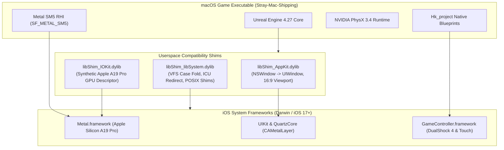

# Reverse Engineering Stray (macOS ARM64) on iOS: Technical Architecture, Metal SM5 Rendering & Skeletal Mesh Forensics

> **Target Audience:** Graphics Engineers, Unreal Engine Core Developers, Metal Specialists, and Reverse Engineers.  
> **Repository:** [ju4nm8/stray-on-ios-research](https://github.com/ju4nm8/stray-on-ios-research)  
> **Status:** Research & Engineering Experiment — **NOT yet fully playable**.

---

## 1. Executive Summary

This project investigates executing the native ARM64 macOS release of **Stray** (built on Unreal Engine 4.27.2) inside an iOS application sandbox on physical Apple Silicon hardware (iPhone 17 Pro Max, iOS 27.x, Apple A19 Pro GPU).

Rather than attempting to recompile the game without source code, we use binary platform adaptation and userspace dynamic library shims derived from `macos-on-ios-public` (by Ross Fisher) to satisfy macOS runtime expectations on iOS:
- **Platform Header Translation:** Mach-O `LC_BUILD_VERSION` adapted to target `IOS` (Platform 7).
- **Userspace Shims:** `AppKit` $\rightarrow$ `UIKit`, synthetic `IOKit` GPU registration (`Apple A19 Pro GPU`), and `libSystem` POSIX filesystem redirects.
- **Current Achievement:** Stray successfully boots, loads PhysX physics, creates a Desktop-class Metal Shader Model 5 (`SF_METAL_SM5`) Dynamic RHI, streams 2.65 GB of level data from cooked PAK archives, accepts touch and DualShock 4 controller input, and renders 3D world geometry at **25–33 FPS** on device.
- **The Current Brick Wall:** While the world geometry renders, the protagonist cat appears as a **pitch-black silhouette**, the 3D main menu background is black, and procedural fur (GFur PRO) fails to render.

---

## 2. Technical Architecture & Shim Pipeline



### Key Shim Milestones Solved:
1. **GPU Recognition Crash (SIGSEGV `0x28`):** Upstream UE4 dereferences `IOAccelerator` registry properties during `FMetalDynamicRHI` startup. `libShim_IOKit` populates a synthetic registry table with `vendorId=0x106b` and `plugin=AGXMetalG18P`.
2. **Metal Storage Mode Incompatibility:** macOS Metal allows `MTLStorageModeManaged` (`1`). iOS unified memory requires `MTLStorageModeShared` (`0`). `libShim_AppKit` interposes `MTLTextureDescriptor` creation to sanitize storage modes.
3. **Texture View Assertions:** Interposing `-[MTLTexture newTextureViewWithPixelFormat:]` prevents crashes when UE4 requests stencil (`260 -> 261`) or depth (`260 -> 252`) remapping on compressed BC formats.
4. **ICU Resource Discovery:** Cooked internationalization tables (3,463 files) are extracted and redirected via `libSystem` VFS hooks.

---

## 3. The Skeletal Mesh & Cat Protagonist Investigation

In earlier tests, the cat protagonist was completely missing. Reverse engineering the binary led to several discoveries:

### 3.1. Binary Probe Instrumentation (Test 40)
We instrumented `USkinnedMeshComponent::CreateSceneProxy` (`0x102fd67a0`) in a binary code cave (`0x1005d03ec`) to log:
- `PRBE`: Function entry, component pointer, skeletal mesh, and `MeshObject`.
- `PRBB`: Section bone comparison (`cmp w22, w0`).
- `PRBX`: Proxy instantiation exit value.

**Resulting Probe Output:**
```text
PRBE 0x13b6eb050  Mesh: 0x13b2b19d0  MeshObject: 0x13b33ea20  RenderData: 0x15047e840
PRBB 0x13b6eb050  MaxGPUSkinBones: 0x100 (256)  SectionBones: 0x0e (14)
PRBX 0x13b6eb050  ResultProxy: 0x13a762c80 (NON-NULL)
```
**Conclusion:** The section bone limit check (`0x102fd68c0`) is **NOT** failing. Section bone counts are ~14, well below the 256 limit. `FSkeletalMeshSceneProxy` is created successfully.

### 3.2. Framebuffer Forensic Analysis (Test 41)
Digital analysis of the native 2868x1320 in-game capture (`test41_ingame.png`) revealed that the cat mesh **IS** physically rasterized. Occlusion analysis shows:
- The silhouette cleanly occludes the background pipes, valves, and wall geometry.
- Pointed ear tips, skull curve, and spine curvature are distinctly visible.
- However, the mesh is **100% black** (pitch-black silhouette).

### 3.3. Causal Breakdown: Why is the Silhouette Black?

1. **Subsurface Profile Shading Model (`MSM_SubsurfaceProfile`):**
   - The cat's body material (`MI_CAT_Body_2sidedshading`) uses Shading Model 5 (`MSM_SubsurfaceProfile`), pointing to `/Game/Character/Cat/Material/SSS_profil_cat`.
   - In UE4's deferred renderer, `MSM_SubsurfaceProfile` outputs diffuse radiance to `SceneColor` and relies on a screen-space post-processing pass (`FPostProcessSubsurface`) to blur and scatter light across the surface.
   - On iOS Metal, this screen-space pass appears to either fail silently or fail to bind intermediate render targets, resulting in unscattered black diffuse output.
   - Forcing `r.SubsurfaceScattering=0` in `Engine.ini` instructs the renderer to fall back to standard Lambertian `MSM_DefaultLit`.

2. **Indirect Lighting via Volumetric Lightmaps (VLM):**
   - The opening level (`Zone01_Intro`) uses static precomputed lighting.
   - Static geometry uses baked 2D lightmaps. Dynamic movable skeletal meshes cannot use 2D lightmaps; they sample the **Volumetric Lightmap** (`PrecomputedVolumetricLightmapAllocation`).
   - In dark interior environments without direct sunlight, if VLM indirect diffuse sampling returns 0, dynamic actors receive 0.0 lumens of ambient light.

3. **GFur PRO Shell Suppression:**
   - Stray uses **GFur PRO** for procedural fur rendering.
   - In native gameplay, `UGFurComponent` suppresses the base mesh by setting `bHideSkin = true` and `bVisible = false`, intending for procedural geometry fin/shell passes to draw the fur.
   - On iOS Metal SM5, GFur's compute shaders or geometry amplification passes do not render, leaving only the base mesh—which was suppressed.
   - We applied surgical binary patches:
     - `0x102fd67f0`: NOP `tbnz w9, #0x8, 0x102fd6840` (`bHideSkin` check).
     - `0x102fd6e44`: NOP `cbz w0, 0x102fd6f34` (`MeshObject` allocation bypass).
     - `0x1008f9134`: In nativized blueprint `ABP_CatPawn_C__pf1235962618`, change `mov w1, #0` to `mov w1, #1` in `SetVisibility`.

---

## 4. Unsolved Problems & Call for Assistance

We are seeking advice and insights from graphics engineers experienced with **Unreal Engine 4 source code**, **Metal deferred shading**, and **custom shading models**:

### Question 1: Overriding `MSM_SubsurfaceProfile` on Cooked Metal SM5 Binaries
Without engine source code re-compilation, how can we reliably force UE4's deferred renderer to evaluate `MSM_SubsurfaceProfile` as standard `MSM_DefaultLit`?
- Does `r.SubsurfaceScattering=0` in `Engine.ini` completely bypass `FPostProcessSubsurface` and render diffuse basecolor directly, or does it discard subsurface radiance entirely?

### Question 2: Volumetric Lightmap Sampling on Dynamic Primitives
Why would static lightmaps render on static geometry while Volumetric Lightmap samples return zero for dynamic movable skeletal meshes?
- Is there a specific console variable (e.g. `r.Cache.LightLevels`, `r.VolumetricLightmap.Enable`) that controls VLM streaming into Metal buffers on Apple Silicon?

### Question 3: Desktop Texture Compression (BC1–BC7) on iOS Metal
macOS cooked PAK archives contain desktop DXT/BC compression formats rather than ASTC:
- How does Apple Silicon iOS GPU handle desktop BC texture sampling when running under an iOS SDK target (`LC_BUILD_VERSION` = 7)?
- Does the Metal driver require specific texture descriptor configuration to sample BC formats without falling back to blank mips?

### Question 4: 3D Main Menu Background Occlusion
In the main menu, UMG/Slate widgets render correctly at 60 FPS, but the background 3D world is pitch black:
- What mechanism in UE4 4.27's viewport composition might disable the world render pass when Slate UI is on top?

---

## 5. Sanitized Evidence & Reproduction

All diagnostic logs, binary disassembly, and sanitized configuration baselines are available in the repository:
- [community/diagnostics/test33_metal_rhi_init.log](diagnostics/test33_metal_rhi_init.log)
- [community/diagnostics/test37_clean_3d_render.log](diagnostics/test37_clean_3d_render.log)
- [community/diagnostics/test40_bone_probe_trace.txt](diagnostics/test40_bone_probe_trace.txt)
- [community/diagnostics/test41_silhouette_analysis.md](diagnostics/test41_silhouette_analysis.md)
- [community/diagnostics/binary_cave_disassembly.txt](diagnostics/binary_cave_disassembly.txt)
- [community/diagnostics/Engine.sanitized.ini](diagnostics/Engine.sanitized.ini)

If you have experience with Unreal Engine's Metal RHI or shader pipelines, your technical insights would be tremendously valuable!
