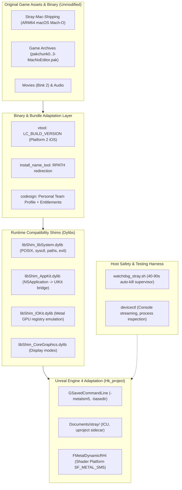

# Architecture Overview — Stray iOS Compatibility Layer

This document describes the engineering architecture used to execute the original ARM64 macOS release of **Stray** inside an iOS application container on physical Apple Silicon iPhone hardware.

---

## Architectural Stack

---

## 1. Binary & Bundle Adaptation Layer

Stray is built as a monolithic shipping executable (`Stray-Mac-Shipping`) linking against macOS system frameworks (AppKit, Cocoa, Carbon, IOKit, OpenGL, AudioUnit). 

To execute on iOS without source code recompilation:
- **Platform Header Adaptation:** The Mach-O load command `LC_BUILD_VERSION` is transformed from `PLATFORM_MACOS` (minOS 12.0) to `PLATFORM_IOS` (`minos 17.0`, `sdk 27.1`) using `vtool`.
- **Dynamic Linking Redirection:** Library load commands targeting macOS system locations (`/System/Library/Frameworks/...`) are rewritten via `install_name_tool` to reference custom shim dynamic libraries bundled within `Frameworks/`.
- **Security & Codesigning:** The application bundle is signed using a valid Apple Developer Personal Team identity. Embedded framework shims are signed first, followed by the outer application bundle.

---

## 2. Runtime Compatibility Shims

The runtime shims intercept calls to macOS-specific APIs and translate them to compatible iOS behaviors:

### A. libShim_libSystem.dylib
- **Filesystem Path Redirection:** Intercepts `stat`, `open`, `access`, and `chdir` to redirect project-relative paths (`../../../Hk_project/...`) and engine assets to valid iOS container locations.
- **Filesystem Case-Sensitivity Bypass:** Hooks `NSURL getResourceValue:forKey:error:` to report `NSURLVolumeSupportsCaseSensitiveNamesKey` as `NO`, preventing Unreal from aborting on case-sensitive APFS volumes.
- **Hardware Spoofing:** Emulates `sysctlbyname` queries:
  - `hw.model` returns `Mac16,12` (Mac mini M4).
  - `hw.machine` returns `arm64`.
  - `hw.memsize` returns total unified memory.
- **Exit & Crash Forensics:** Intercepts `_Exit`, `_exit`, `exit`, and `abort` with reentrancy protection (`gInHook`) to log stack backtraces and dump global engine state before process shutdown.

### B. libShim_AppKit.dylib
- **Application Lifecycle:** Bridges `NSApplicationMain` to `UIApplicationMain`.
- **Window & Viewport Management:** Creates a full-screen `UIWindow` containing a `CAMetalLayer`-backed `UIView` that masquerades as an `NSWindow` / `NSView` for Unreal's `FMetalView`.
- **Command Line Injection:** Overrides `GSavedCommandLine` to inject mandatory launch parameters (`-metalsm5`, `-basedir`, project path).

### C. libShim_IOKit.dylib
- **GPU Registry Emulation:** Unreal's macOS platform layer queries IOKit (`IOServiceGetMatchingServices`) to discover GPU properties and VRAM limits. The shim emulates these registry entries by querying the actual `MTLDevice` on the iPhone.

---

## 3. Unreal Engine 4 Runtime Architecture

Stray runs on a custom build of **Unreal Engine 4** (`Hk_project`). The engine initialization sequence consists of:

1. **`main` / `NSApplicationMain`:** Enters `-[UE4AppDelegate applicationDidFinishLaunching:]`.
2. **Game Thread Spawn:** `FCocoaGameThread` launches and invokes `-[UE4AppDelegate runGameThread:]`.
3. **`GuardedMain`:**
   - **`FEngineLoop::PreInit`:**
     - Platform discovery and hardware classification.
     - ICU data directory discovery (resolved via `Documents/stray/StrayICU`).
     - Project descriptor parsing (`Hk_project.uproject`).
     - Configuration system initialization (`BaseEngine.ini`, `DefaultEngine.ini`).
     - Dynamic RHI creation (`PlatformCreateDynamicRHI` -> `FMetalDynamicRHI`).
     - Global shader map compilation / cache loading (`GlobalShaderCache-SF_METAL_SM5.bin`).
   - **`FEngineLoop::Init`:** Module loading, audio initialization, and level loading.
   - **`FEngineLoop::Tick`:** Core simulation and rendering loop.

---

## 4. Host Safety & Testing Harness

Because tests are conducted on a physical device, thermal management and battery health are strictly maintained:
- **Independent Host Watchdog:** `tools/watchdog_stray.sh` spawns alongside each launch and forcibly terminates the process if execution exceeds the timeout (configured between 40s and 90s).
- **Process Cleanup Verification:** Every test run verifies via `devicectl` that no zombie or suspended processes remain in memory.
- **Inter-run Cooldown:** Testing guidelines mandate cooldown intervals between consecutive test launches.
